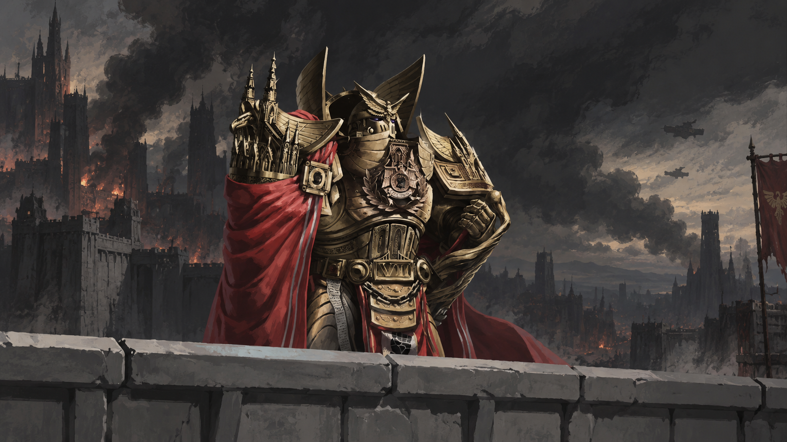
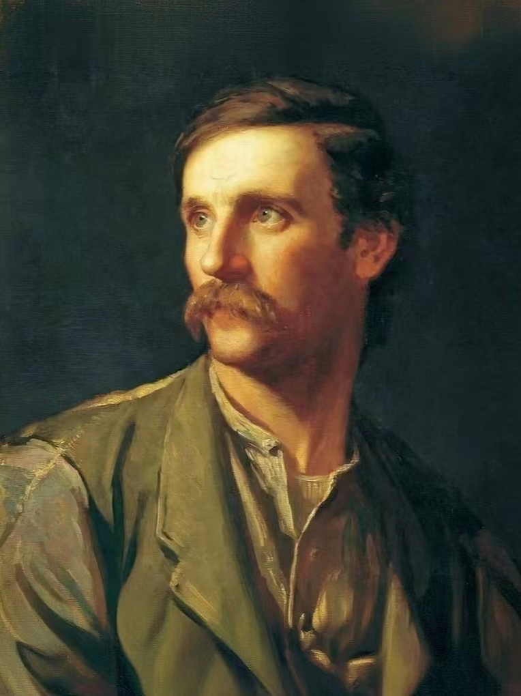

## 引言

>过去的我并不愚蠢，现在的我还在前进，而未来的我也无法完美。

## 个人基本信息简介

- 邮箱： `kongchenkui@gmail.com`
- X ： `https://x.com/Kong_chenkui`
- github：`https://github.com/kong-chenkui`
- 兴趣偏好：  
  
  1.影视方面欣赏西欧戏剧（现代欧美戏剧占比更多，`举例有 《俄狄浦斯王》-索福克勒斯，《贵妇还乡》- 迪伦马特  ，《山羊或谁是希尔维亚》- 爱德华阿尔比...`）和电影（争取有生之年把 `imdb top250` 都看完）  
  
  2.音乐方面爱听`日语citypop` 和 `古典乐`，这两种类型分别取出几个代表，`《Plastic Love》 - 竹内玛莉亚 ，《OH NO, OH YES!》- 中森明菜`，`《Vltava》 - Bedřich Smetana（贝德里赫·斯迈塔纳），《拉赫玛尼诺夫第二钢琴协奏曲》-拉赫玛尼诺夫`  

  3.娱乐方面更喜欢看书，我希望将自己的精力尽可能花在已经过时间检验的文学作品上，典型代表有 `陀思妥耶夫斯基 ，毛姆 ，鲁迅 ，契诃夫，卡夫卡`等，文学作品审美可能更接近存在主义倾向，读完不会快乐，但至少内心的感受仿佛被理解
  
  4.游戏几乎不玩，相较于玩游戏，我更喜欢看别人玩，因为视频博主已经把高潮部分剪辑处理好了，并且我也确实没有静下心来慢慢打游戏通关的能力。即使玩，也是 `MC or Terraria` 开作弊模式去搞建筑。比起痛快酣畅的游戏体验，我想我更喜欢创造。  
  
## 关于我的审美品位

### 零、序

我的过去从来不是现在的反面，我曾经所犯下的错误，不成熟的冲动，自卑，敏感，傲慢，都参与并形成了现在的我，它们是我现在人格的一部分，否认它们就是在否认现在的我。而且，无论我多么谨小慎微，我都不可能变得完美。我唯一所能做的，就是尽可能不再犯同样的错误。  

这篇文章最主要的目的是让读者认识到一位具体的人，因此，它不是一幅道德宣誓词，也不会用`为天地立心，为生民立命`之流的语句来堆砌。

### 一、对待生命的态度

我应当以怎样的态度面对自己的生命？

对我个人而言，我希望自己的一生带有一种严肃的目的性。我的生命一定得有一个目的，有一个目标，我才活得下去。我得有一个值得我用一生去经营的事情去做，这样我的生命才能不算做浪费。它不仅仅包含在传统的事业范围内，也从来不仅仅和赚钱相互划等号，经营好自己的家庭，照顾好自己的爱人，教导好自己的孩子，对我来说同样是一个非常严肃的目标。

区别在于，它是我自己选的，是我所认定的生命中的最高秩序，而不是由社会或者任何一个人强制要求我的。只要我认定，那么我势必将其履行。

但是，这并不意味着我终日严肃，也不意味着生命中的每一个瞬间都必须证明自己的价值。否则，责任就很容易从一种值得敬重的德性，变成一种不允许自己幸福的自我惩罚。  

我只是认为，生命不应当完全交给偶然的欲望、外界的评价与短暂的欢愉。我希望有所追求，有所创造，有值得守护的人，也有值得承担的责任。倘若有一天回首往事，我希望看到的不是一个始终正确、从未失败的人，而是一个曾经认真生活、认真思考，也认真履行自己所认定之责任的人。

Warhammer 40k 中，有一些片段非常打动我。

> Only in death does duty end.  
  
> “你希望着安宁。”那男人说道。  
“是的。”西吉斯蒙德说道。  
“你不会拥有它的，你的一生仅为一个目的而存在。你有目的。”  
“什么目的。”  
“坚守（To stand）。”  
“为什么？”  
“因为必须要有人来做。”  
他扫了西吉斯蒙德一眼，理解但不评判，坚定而又悲伤。  
而西吉斯蒙德从他的眼神中看出了疲惫，就像一个早已走了很远的路，但是还要走得更远的人。

这段文字可以视为整篇文章的精神起点。它们包含一种沉重的责任伦理。每次看到的时候，不知为何，我总是想要落泪。

它们告诉我，生命是一场有期限的服役。在我的生命当中，我是因为某一个目的而存在，我的生命也因此而确立，当我达成之后，死亡便是对我的奖励。这是我的安息，让我永远可以享受安宁。之前的我很害怕死亡，因为对我来说，死亡意味着结束，意味着生命体验的终结。我再也无法感知到周遭世界的存在，因此我对死亡充满厌恶和恐慌。可是如今，我却并不害怕。因为对于一个早已走了很远的路的人来说，休息不正是他所渴望的吗？死亡在此刻的语境中，反倒有了一丝温柔的情调。而活着，就意味着我对周遭有所承担。

### 二、我是如何成为如今的模样

我并不是从一开始就理解责任的含义。  

我对责任最开始的概念并非来自哲学著作，也不是某种精心构造的道德理论，而是来自我父亲的言传身教。他没有显赫的地位，没有值得向世人夸耀的功绩，他仅仅只是一位出卖体力的农民工，却用自己的劳动、坚守与承担，为我创造了比他年轻时更加宽广的生活。一个人的伟大未必需要宏大的历史叙事。有时它表现为无数个平凡日子里的选择，表现为即使无人称赞，也依然认真履行自己所承担的职责。  

我欣赏的男性原型（archetype）都具备着古典（classical）的气息。他们展示给世人的形象各不相同，但是对于责任，牺牲，守护等一系列内核都保持着高度统一。举例，耶稣基督、擎天柱（特指动画《领袖之证》）、rogal dorn、木法沙、鹿王（来自《小鹿斑比》）、成龙（特指动画《成龙历险记》）......

我常常被他们伟岸的人格形象所打动。我希望自己坚定、理性、沉着，能够在困难面前承担责任。但在现实生活中，我却并不总能做到这些。我有时急于证明自己，有时过于相信未经验证的判断，也曾把一时的冲动误认为果断。我现在才逐渐意识到，欣赏一种德性，与真正拥有它，是两件不同的事情。理想能够指引一个人，却不能代替我经历现实的磨炼。  

我要走的路，真的还有很长很长。

### 三、关于我的日常生活美学

接下来的话题算是我身上相当具有辨识度的一部分。

我欣赏音乐、戏剧、电影。

音乐让我的内心受到触动，我喜爱具有年代感的日语citypop。每每听到它们，不知为何，我的心里总是有一股落寞与惆怅，像是在感叹一个美好岁月的逝去。而古典音乐带给我的，则是听觉上的艺术震撼。我最喜欢的古典乐曲是 斯美塔那的 《我的祖国》第二乐章《沃尔塔瓦河（vltava）》。它美得简直不像一首音乐，更像一幅画。我希望自己有生之年，一定到维也纳听新年音乐会。

对于电影，我一般就按照`imdb top250` 这样的榜单，照着顺序看下去就完了，不一定每一部都合我的胃口，但是免去了我自己精挑细选的折磨。电影是人类最为美妙的艺术品之一，短短几个小时，就能品味一段岁月，甚至还能不断激发我的联想，让忍不住再影片结束之后依然回味。举几个我看过的印象深刻的，《公民凯恩》、《佩达布斯大饭店》、《十二怒汉》、《花样年华》、《飞屋环游记》......

然后就是戏剧。我喜爱上戏剧完全是受到我的西方戏剧文化老师的影响，她在大学课堂上的讲述勾起了我对戏剧的兴趣。就我观感而言，悲剧编写得最为精妙，而荒诞派戏剧最为好玩。

### 四、我希望成为一个怎样的人？

我不知道自己最终能够抵达什么地方。也许我的事业并不显赫，我的作品也未必能够得到世人的认可。但我仍然希望保有认真工作的习惯，保有对知识和创造的热情，保有面对错误时修正自己的勇气。 

我希望随着年龄增长，自己的身体更加强壮，判断更加审慎，行动更加果断，对他人更加宽厚，对自己更加诚实。我希望自己不只是成为一个有能力的人，也能成为一个值得信赖、能够理解他人，并且仍然热爱生活的人。

以下是我用了快十年的头像，从初中到现在大四，中间换过几次，但是兜兜转转，每次都会重新使用它。我不知道这张图片到底有着怎样的魅力，或许是和我所向往的状态太过相似。

## commit history

初版定于 2026.10.31，文笔和思想都略显稚嫩，但是大体的思想倾向已经确立，后续会逐渐优化表述，增删内容。