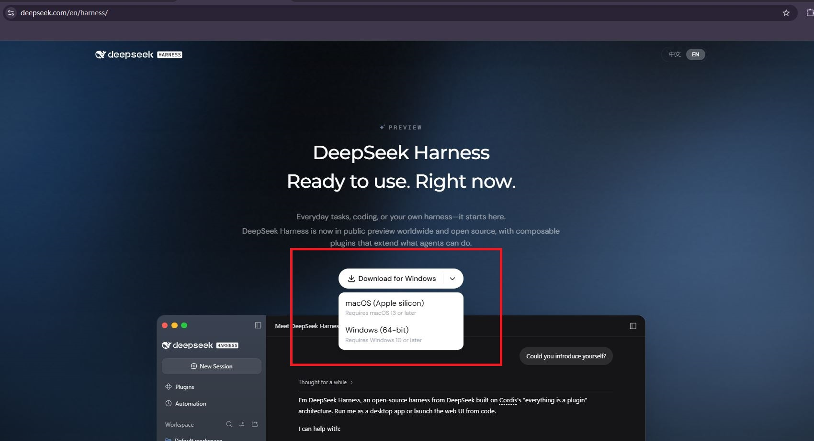
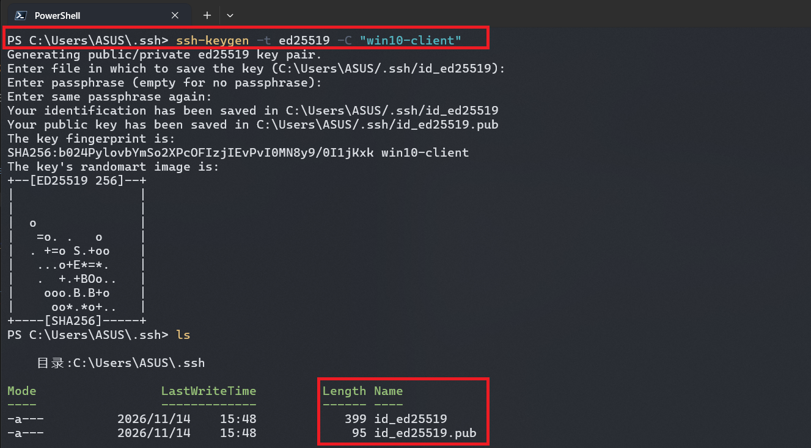
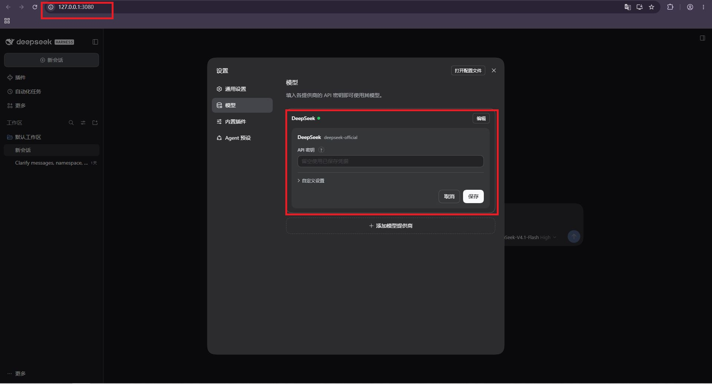

## 文章摘要
 DeepSeek Harness（简称 DSH）,  DeepSeek 官方开源的 Agent 运行框架，用 TypeScript 编写。 本文的主要内容是部署 DSH 在设备上,同时 建立 SSH 隧道实现端口映射。

## 部署 DSH

### 一、DSH Desktop的部署
 对于 Windows or macOS 系，最直接的部署方式是前往 `https://www.deepseek.com/en/harness/` 下载对应的桌面版安装包



### 二、官方 CLI / Web UI 路径 

首先是配备 Node.js 通用环境,  

- 对于 Windows
```
winget install OpenJS.NodeJS.LTS #使用 winget 工具部署 nodejs 环境
node -v  #重新打开一个终端窗口,Node 应输出 v24.x.x，且不低于 24.9.0
```

- 对于 macOS
```
brew install node
node -v     #Node 应输出 v24.x.x，且不低于 24.9.0
```

- 对于 Linux
```
#执行该命令不要使用 sudo
curl -fsSL https://raw.githubusercontent.com/nvm-sh/nvm/v0.40.4/install.sh | bash
```
Linux 执行完该命令后，重启终端窗口，依次执行
```
command -v nvm # 此命令应输出结果应该为 nvm。
nvm install 24 
nvm use 24

# 检查环境是否部署合适的组件
node --version # Node 应输出 v24.x.x，且不低于 24.9.0
npm --version # npm 也应输出版本号
```  

Node.js 环境配置完成，下面开始正式部署 DSH。因为 npx 和 npm 是 Node.js 自带的跨平台工具，所以Windows / macOS / Linux 命令完全一致。


- 首次安装 DSH ，使用 npx
```
npx @deepseek-ai/dsh web  # 临时安装,自动拉取最新版
```
该命令适合临时体验与快速验证 DSH，打开系统浏览器观察 该地址[`http://127.0.0.1:3080`]上的 DSH 运行效果.

- 确认无误之后，在终端取消 npx 的 dsh 进程管理，使用 npm 全局安装
```
npm install -g @deepseek-ai/dsh # 全局安装,自动拉取稳定版
dsh web #启动 dsh

#后续的升级
npm update -g @deepseek-ai/dsh
```

部署完成后，在 Web UI 界面处配置账号或者模型密钥。

### 三、源码部署DSH

当使用者需要修改底层配置、调试或开发自定义插件时，从源码部署。

DSH 源码使用 pnpm 管理依赖，首先是对 pnpm 的部署，

```
# 用 npm 全局安装（Windows / macOS / Linux 通用）
npm install -g pnpm
pnpm -v     # 验证安装成功

# macOS 也可用 Homebrew
 brew install pnpm
```
其次，需要完成对 git 的部署，笔者不予赘述。（如果连 git 工具都不会部署的话，给我去门口罚站 👀）

然后进行源码部署。
```
# 克隆仓库
git clone https://github.com/deepseek-ai/deepseek-harness.git
# 进入项目目录
cd deepseek-harness

# 安装依赖
pnpm install

# 编译
pnpm run build

# 启动 Web 服务
pnpm dsh web
```

## SSH 连接

笔者的配置策略为使用 Windows 系统作为 SSH 服务的客户端，Debian 作为该远程服务的服务端，DSH 实际上是跑在Linux 系统上。而 DSH 默认只监听 `127.0.0.1:3080` 的本机回环端口。

### 该部署策略的缘由
最开始，笔者的部署策略是服务端和客户端均为 Windows 系统，但是实际使用体验发现，DSH 在微软系统上运行不够令人满意，很多命令和软件无法正常调用，即使 Windows 的远程桌面连接做的效果很好，但是为了保证 Agent 的正常运行，笔者只好放弃。

接着，笔者将服务端替换为 Debian，服务是调用起来了，但是使用远程桌面连接的体验简直就是糟糕，界面卡得要死。最终，笔者只好放弃对 Linux 的远程桌面控制连接。

但是由于 DSH 默认只监听 `127.0.0.1:3080` 的本机回环端口，所以只好使用 SSH 服务做好双方 3080 端口的映射。

### 部署SSH服务

1. 在客户端生成一对 SSH 连接的公私钥。

```
ssh-keygen -t ed25519 -C "win10-client" # 生成 Ed25519 密钥 ，引号中的 win10-client 为备注，可替换为其他字符
```
注意：
```
ssh-keygen -t ed25519 -C "win10-client" -f ~/.ssh/自定义名称
```
可以自定义公私钥的名称，但是进行ssh连接需要指定该密钥，否则密钥配对会失效，而使用默认生成的密钥名称则可以不用 -i 参数来指定密钥
```
ssh -i ~/.ssh/自定义名称 user@server_ip
```

接着会依次提示 `Enter file in which to save the key` 和 `Enter passphrase` ，两次直接回车，不做多余操作。这样，生成的公私钥密钥对就直接放在 `~/.ssh` 目录下，会看到类似提示。



2. 部署 SSH server 服务

将生成的公钥内容进行复制，转移到 Linux 服务器上面去。
```
PS C:\Users\user\.ssh> cat .\id_ed25519.pub
ssh-ed25519 AAAAC3NzaC1lZDI1NTE5AAAAIP/HOs3XnxA62JpExqqGuoriOo/J21Rnbv51bZQv1O1l win10-client
```
在服务端生成目录`~/.ssh` 和文件 `~/.ssh/authorized_keys`，公钥内容转移到该文件上，并且赋予它们正确的执行权限
```
chmod 700 ~/.ssh
chmod 600 ~/.ssh/authorized_keys
```
接着部署 openssh server 服务

```
sudo apt update
sudo apt install -y openssh-server
sudo systemctl enable --now ssh # 启动该 server 服务，并且设置开机自启
sudo systemctl status ssh # 查看服务状态
ss -tlnp | grep ssh # 查看监听端口（默认 22）
```
3. 实行 SSH 连接

确定好所在网段的 ipv4 地址与设备的 username ，使用如下命令查询，
```
user@debian:~$ hostname -I
192.168.40.148 
user@debian:~$ whoami
user
```
之后使用 ssh 连接，完成 3080 端口的映射
```
ssh -N -L 3080:127.0.0.1:3080 user@192.168.40.148
```
现在本机的 127.0.0.1:3080 即可初步访问 192.168.40.148 上的 本机回环 3080 端口上的 dsh 服务了。



4. nssm 配置 windows 后台服务

现在可以初步对 ssh 进行连接了，但是存在两个问题。

- 第一，后续的DSH使用插件时，如果启用除了3080以外的端口，那么客户端就无法使用，因为客户端与服务端之间建立的连接仅限于 3080 这个端口
- 第二，每次在使用前都需要单独开一个终端窗口输入 ssh 的连接命令非常繁琐，笔者期望做一个类似于 linux 的 systemctl 的守护进程管理，可以开机自启与崩溃重启。

因此，笔者做了两项处理模式。


- 第一，开设一条 socks 代理 1080 端口，做到几乎全流量代理，通过 1080 

- 第二，笔者决定使用 nssm 这个 windows 后台注册服务。该项目的作者早已不再对其进行维护，但是，由于此次只是做一个 ssh 的 后台注册服务，并不需要特别复杂的守护进程，所以选择 nssm 这个相对好上手的设置。

具体实现过程如下：

（`https://nssm.cc/download`，下载 nssm-2.24 zip包，自行选择好一个位置进行解压，笔者是放置在 `C:\Program Files` 目录下）

首先，进行 nssm 服务的注册,以管理员身份运行 powershell。完成 ssh 服务的后台守护进程。其中，这次的修改部分为，在进行客户端和服务端的 ssh 连接时，除了 127.0.0.1:3080 ，还进行了 1080 代理的配置。

```
# 替换成 nssm.exe 实际存放的路径
$nssm = "C:\Program Files\nssm-2.24\win64\nssm.exe"  

# 设置 nssm 的服务名
$serviceName = "ssh-tunnel-multi"

# 如果要覆盖旧服务，先停掉并删除（可选）
# & $nssm stop ssh-tunnel-3080
# & $nssm remove ssh-tunnel-3080 confirm

# 安装服务（密钥如果是使用自定义的名称，则需要使用 -i 参数进行实际位置的指定）
& $nssm install $serviceName `
    "C:\Windows\System32\OpenSSH\ssh.exe" `
    "-N -D 1080 -L 3080:127.0.0.1:3080 -L 2200:127.0.0.1:22 -i C:\Users\user\.ssh\dsh_yuxi_sshkey -o ServerAliveInterval=30 -o ExitOnForwardFailure=yes user@192.168.40.148"

# 工作目录
& $nssm set $serviceName AppDirectory "C:\Users\user"

# 日志
& $nssm set $serviceName AppStdout "C:\Users\user\.ssh\ssh-tunnel-multi.log"
& $nssm set $serviceName AppStderr "C:\Users\user\.ssh\ssh-tunnel-multi.err.log"
& $nssm set $serviceName AppRotateFiles 1
& $nssm set $serviceName AppRotateBytes 1048576

# 崩溃后自动重启
& $nssm set $serviceName AppExit Default Restart
& $nssm set $serviceName AppRestartDelay 5000

# 开机自启
& $nssm set $serviceName Start SERVICE_AUTO_START

# 用指定用户身份运行（必须）
& $nssm set $serviceName ObjectName ".\user" "你的Windows登录密码"

# 启动并查看状态
& $nssm start $serviceName
& $nssm status $serviceName

```

其次是 chrome 的桌面快捷方式的制作，其中的 url 是dsh web 在 ssh 服务端的终端产生的

```

"C:\Program Files\Google\Chrome\Application\chrome.exe" --proxy-server="socks5://127.0.0.1:1080" --proxy-bypass-list="<-loopback>" --user-data-dir="C:\Users\user\AppData\Local\dsh-remote-profile" "http://127.0.0.1:3080/?token=<从 Debian 终端 dsh web 启动那行复制>"

```

最终效果：

几乎所有流量都会走客户端的 socks5://127.0.0.1:1080 。

因此，在该 chrome 实例中：
- 访问外网 → 走 1080
- 访问其他任何地址 → 同样走 1080
- 没有其他 bypass 规则，所以基本是“全流量代理”。

## 参考资料

1. Roceo 《DeepSeek Harness本地部署》[https://zhuanlan.zhihu.com/p/2074129137472640843]  
2. DeepseekDSH 《在 Linux 上安装 DeepSeek Harness》 [https://deepseekdsh.com/zh/tutorials/linux]

